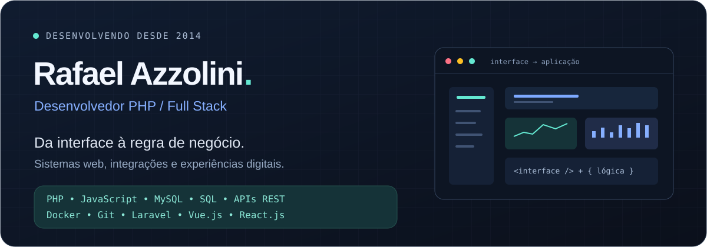

  

  
  &nbsp;
  

 

### Código que conecta interface, dados e negócio.

Sou **Rafael Bueno Azzolini**, desenvolvedor com atuação desde **2014**. Trabalho na criação e evolução de aplicações web, com experiência em **ERPs, sistemas judiciais, financeiros e plataformas de gestão**.

Minha atuação vai das interfaces e interações no front-end às regras de negócio, bancos de dados e integrações no back-end.

 

<table>
  <tr>
    <td width="50%" valign="top">
      <h3>01 / Interfaces</h3>
      
Desenvolvimento de interfaces web, painéis administrativos e interações com JavaScript, jQuery e AJAX.

      
<strong>HTML · CSS · JavaScript · Bootstrap</strong>

    </td>
    <td width="50%" valign="top">
      <h3>02 / Sistemas</h3>
      
Novas funcionalidades, evolução de sistemas existentes, APIs REST e integração com bancos de dados.

      
<strong>PHP · POO · MVC · SQL</strong>

    </td>
  </tr>
</table>

 

### Minha caixa de ferramentas

**Desenvolvimento**

  

**Dados e ambiente**

  

 

### Próximos capítulos

Aprofundando conhecimentos em **Laravel**, **arquitetura SaaS** e **inteligência artificial aplicada ao desenvolvimento**.

→ [Conheça minha experiência e os projetos no portfólio](https://rafaelazzolini.com.br)

---

  

